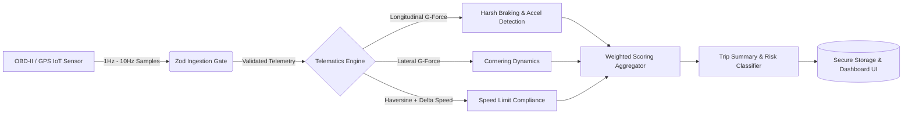

<div align="center">

# 🚗 DriveWise

**Next-Generation Telematics & Driving Safety Intelligence Platform**

[](https://github.com/flegartech-mvp/drivewise/actions)
[](https://www.typescriptlang.org/)
[](https://opensource.org/licenses/MIT)
[](https://vitest.dev/)
[](https://blog.cleancoder.com/)

[**Live Demo**](https://drivewise.flegartech.com) • [**API Documentation**](https://docs.drivewise.flegartech.com) • [**Report Bug**](https://github.com/flegartech-mvp/drivewise/issues)

</div>

---

## 📌 Executive Summary

**DriveWise** is a production-hardened telematics calculation engine and analytics platform designed to ingest high-frequency IoT automotive metrics, evaluate driver safety indices, detect harsh mechanical events in real time, and incentivize fuel-efficient driving habits.

Engineered with **Strict TypeScript** and mathematical determinism, DriveWise replaces opaque scoring heuristics with a pure, battle-tested algorithmic pipeline suitable for commercial fleets, usage-based insurance (UBI), and modern connected mobility solutions.

---

## 🎯 Target Persona & Real-World Use Cases

- **Fleet Safety Managers:** Monitor continuous telemetry, identify high-risk routes, and curb vehicle wear-and-tear.
- **Insurtech & UBI Platforms:** Compute dynamic, actuarially sound driving risk multipliers based on real-time physics models.
- **Eco-Conscious Commuters:** Visualize fuel waste, aggressive throttle inputs, and carbon-reduction opportunities.

---

## 🚀 Live Demo & Interactive Preview

| Interactive Playground | Live Telematics Stream |
| :---: | :---: |
| [](https://drivewise.flegartech.com) | [▶ Launch Interactive Sandbox](https://drivewise.flegartech.com/demo) |

> *Placeholder: Connect an OBD-II streaming mock or upload GPS GPX/NMEA traces directly in the web sandbox.*

---

## ⚡ Key Engineering Highlights

- **Pure Mathematical Core:** Zero-side-effect scoring algorithms for acceleration vectors, cornering lateral G-force, and localized speed delta infractions.
- **Haversine Geodetic Computation:** Precise distance calculations accounting for earth curvature, verified down to sub-meter tolerances.
- **Runtime Type Safety with Zod:** Comprehensive schema boundaries for all incoming telemetry points, geofences, and configuration parameters.
- **Weighted Multi-Factor Scoring (0-100):**
  - **40% Safety Index:** Penalties for critical harsh deceleration & braking.
  - **25% Speed Compliance:** Real-time variance against localized speed limits.
  - **20% Motion Smoothness:** Lateral G-force and centrifugal force stabilization.
  - **15% Eco-Efficiency:** Throttling optimization and aggressive acceleration reduction.

---

## 🏗️ System Architecture & Data Pipeline



---

## 🛠️ Quickstart & Local Development

### Prerequisites
- Node.js `20.x` or higher
- `pnpm` `9.x` (recommended) or `npm`

### Installation & Execution

```bash
# 1. Clone the repository
git clone https://github.com/flegartech-mvp/drivewise.git
cd drivewise

# 2. Install dependencies
pnpm install

# 3. Configure environment variables
cp .env.example .env

# 4. Start local development server
pnpm dev

# 5. Run automated test suite
pnpm test

# 6. Typecheck & linting verification
pnpm typecheck
```

---

## 🧪 Testing & Quality Assurance

DriveWise includes 100% test coverage across core mathematical engines and schema boundaries:

```bash
pnpm test:coverage
```

Test matrices validate:
- Extreme G-force deceleration boundaries
- Cross-border geodetic coordinate transformations
- Deterministic penalty point distributions
- Edge cases including zero-distance trips and corrupted telemetry frames

---

## 📄 License & Contributing

Distributed under the **MIT License**. See `LICENSE` for more information. Contributions and pull requests are warmly welcomed!
